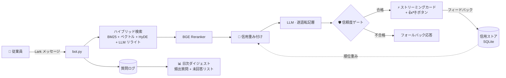

<div align="center">

# 🏢 Lark HR  Q&A ボット

**エンタープライズ向け HR アシスタント — 設計上ハルシネーションなし**

回答はナレッジベースの原文を一字一句そのまま転記し、出典リンクを添付。
LLM が勝手に創作することは、決してありません。

[](https://www.python.org/)
[](https://www.larksuite.com/)
[](#-アーキテクチャ)
[](#-フィードバック信用重み付け)
[](LICENSE)

[English](README.md) · [简体中文](README.zh-CN.md) · **日本語** · [한국어](README.ko.md)

</div>

---

## ✨ 他のボットとの違い

ほとんどの RAG ボットは LLM に検索結果を「書き換え」させるため、ハルシネーションを引き継いでしまいます。
本ボットは逆の原則で設計されています：

> **回答はナレッジベース原文の逐語転記＋出典リンクでなければならない。モデルは検索・整形層であり、著者ではない。**

| 機能 | 説明 |
|---|---|
| 📜 **逐語転記** | 厳格なプロンプト契約 + 引用検証：すべての主張が KB 原文に遡及可能 |
| 🏦 **フィードバック信用重み付け** | 👍/👎 を文書ごとの信用スコアに蓄積し、以後の検索順位に反映 — マルチエージェントの信用スコアリングに着想 |
| 🛡️ **信頼度ゲート** | 送信前に LLM が自己検証。原文に遡れない回答は自動で格下げまたは完全に遮断 |
| ⚡ **ストリーミングカード** | トークン生成と同時に Lark カードをライブ更新。フィードバックボタン付き |
| 🌐 **バイリンガル** | 言語自動判定（中文 / English）、バイリンガル KB 対応 |
| 🔄 **自己修復ループ** | 未回答の質問を記録 → 日次ダイジェスト → 管理者承認 → KB が継続的に改善 |
| 🩺 **本番運用レベル** | プロセス内再接続、フェイルセーフ、スケジュール連動ウォッチドッグ（launchd） |
| 📊 **オフライン A/B 評価** | `eval_kb.py --compare` で変更が非退行であることを証明してからリリース |

---

## 🏗 アーキテクチャ



---

## 🏦 フィードバック信用重み付け

マルチエージェントシステムの**信用スコアリング**（Manus 等）に着想を得て、検索層に適用：

```
credit(doc)  = (👍 + α) / (👍 + 👎 + 2α)        # ベイズ平滑化、α = 2
weight(doc)  = W_min + (W_max − W_min) × credit  # ∈ [0.7, 1.3]
最終スコア   = reranker スコア × weight(doc)
```

- 新規文書は**中立**（credit 0.5 → weight 1.0）から開始 — コールドスタートバイアスなし
- 繰り返し低評価されたソースは沈み、検証されたソースは浮上
- **順位付けのみ**：回答生成には一切触れないため、ハルシネーションを持ち込まない
- 有効化前に検証：`python3 eval_kb.py --compare` で ON/OFF の精度差を出力

---

## 🛡️ 信頼度ゲート

生成されたすべての回答は、検索コンテキストとの照合（LLM 自己検証）を経ます。
原文に遡れない主張は設定に応じて格下げされます：

| モード | 動作 |
|---|---|
| `note`（デフォルト） | 回答を送信 + 確認注意書きを付記 |
| `fallback` | **回答を完全に保留** — 慎重なフォールバック文に置き換え |

`config.py` で設定：`SELF_CHECK_MODE = "fallback"`

---

## 🚀 クイックスタート

```bash
# 1. 依存関係のインストール
pip install -r requirements.txt

# 2. 設定（Lark アプリ認証情報 / LLM ゲートウェイ / 管理者 open_id）
cp config.example.py config.py && vi config.py

# 3. ポリシー文書をナレッジベースへ
cp your-policy.md kb/

# 4. 起動
python3 bot.py
```

オプション — Lark wiki から KB を自動同期：`sync_sources.example.json` を `sync_sources.json` にコピーし、文書 URL を入力して `python3 lark_sync.py` を実行。

---

## 📁 プロジェクト構成

| ファイル | 役割 |
|---|---|
| `bot.py` | メインアプリ：Lark WebSocket、メッセージ振分、カード UI、再接続・監視 |
| `llm.py` | LLM 層：プロンプト契約、ガード、ストリーミング、自己検証 |
| `credit_store.py` | 🏦 フィードバック信用重み付け（SQLite） |
| `kb.py` · `index_manager.py` · `vector_store.py` · `reranker.py` | ハイブリッド検索パイプライン |
| `question_log.py` | 質問ログ、フィードバック、日次ダイジェスト |
| `kb_healer.py` | KB 自己修復提案（管理者承認制） |
| `lark_sync.py` | Lark wiki/docx から KB 自動同期 |
| `eval_kb.py` | オフライン評価：LLM-as-judge 採点 + A/B 比較 |
| `watchdog.sh` | スケジュール連動の外部ウォッチドッグ（launchd） |

---

## 📊 評価

```bash
python3 eval_kb.py              # フル評価：忠実性 / 網羅性 / リンク精度
python3 eval_kb.py --compare    # A/B：信用重み付け OFF vs ON
python3 eval_kb.py --files 休暇ポリシー.md --limit 20   # クイックデバッグ
```

採点は LLM-as-judge が 3 軸で実施：**忠実性**（KB を超えた主張がない）、**網羅性**（重要事実の欠落がない）、**リンク精度**（正しい出典文書）。

---

## 🔧 運用

- `launchd` KeepAlive + `watchdog.sh`（勤務時間連動）
- Lark DM の管理者コマンド：`重载知识库` / `同步知识库`
- すべての変更は `eval_kb.py` をゲートに — 退行はリリースしない

---

<div align="center">

**License:** MIT · HR チームのために ❤️ を込めて

</div>
