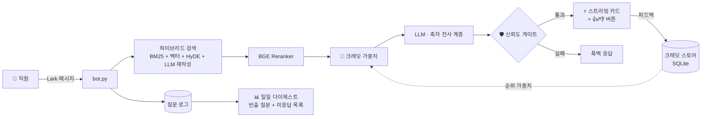

<div align="center">

# 🏢 Lark HR Q&A 봇

**엔터프라이즈급 HR 어시스턴트 — 설계 단계부터 할루시네이션 제로**

답변은 지식 베이스 원문을 한 글자도 바꾸지 않고 전사하고 출처 링크를 첨부합니다.
LLM이 임의로 창작하는 일은 결코 없습니다.

[](https://www.python.org/)
[](https://www.larksuite.com/)
[](#-아키텍처)
[](#-피드백-크레딧-가중치)
[](LICENSE)

[English](README.md) · [简体中文](README.zh-CN.md) · [日本語](README.ja.md) · **한국어**

</div>

---

## ✨ 이 봇이 다른 이유

대부분의 RAG 봇은 LLM이 검색 결과를 *재작성*하도록 두어 할루시네이션을 그대로 물려받습니다.
이 봇은 정반대 원칙으로 설계되었습니다:

> **답변은 반드시 지식 베이스 원문의 축자 전사 + 출처 링크여야 한다. 모델은 검색·포맷 계층이지 저자가 아니다.**

| 기능 | 설명 |
|---|---|
| 📜 **원문 축자 전사** | 엄격한 프롬프트 계약 + 인용 검증: 모든 주장을 KB 원문으로 추적 가능 |
| 🏦 **피드백 크레딧 가중치** | 👍/👎 피드백을 문서별 크레딧 점수로 축적해 이후 검색 순위에 반영 — 멀티 에이전트 신뢰 스코어링에서 영감 |
| 🛡️ **신뢰도 게이트** | 전송 전 LLM 자가 검증. 원문 추적이 불가한 답변은 자동 강등 또는 완전 차단 |
| ⚡ **스트리밍 카드** | 토큰 생성과 동시에 Lark 카드 실시간 갱신, 피드백 버튼 포함 |
| 🌐 **이중 언어** | 언어 자동 감지(中文/English), 이중 언어 KB 지원 |
| 🔄 **자가 치유 루프** | 미응답 질문 기록 → 일일 다이제스트 → 관리자 승인 → KB 지속 개선 |
| 🩺 **프로덕션급 운영** | 인프로세스 재연결, 페일세이프 퓨즈, 스케줄 인식 워치독(launchd) |
| 📊 **오프라인 A/B 평가** | `eval_kb.py --compare`로 변경이 무퇴행임을 증명한 후 배포 |

---

## 🏗 아키텍처



---

## 🏦 피드백 크레딧 가중치

멀티 에이전트 시스템의 **신뢰 스코어링**(예: Manus)에서 영감을 받아 검색 계층에 적용:

```
credit(doc)  = (👍 + α) / (👍 + 👎 + 2α)        # 베이지안 스묇ィング, α = 2
weight(doc)  = W_min + (W_max − W_min) × credit  # ∈ [0.7, 1.3]
최종 점수    = reranker 점수 × weight(doc)
```

- 신규 문서는 **중립**(credit 0.5 → weight 1.0)으로 시작 — 콜드 스타트 편향 없음
- 반복적으로 부정 평가된 소스는 가라앉고, 검증된 소스는 상승
- **순위만 변경**: 답변 생성에는 전혀 관여하지 않으므로 할루시네이션 유입 불가
- 활성화 전 검증: `python3 eval_kb.py --compare`가 ON/OFF 정확도 차이를 출력

---

## 🛡️ 신뢰도 게이트

생성된 모든 답변은 검색 컨텍스트와의 대조(LLM 자가 검증)를 거칩니다.
원문으로 추적할 수 없는 주장은 설정에 따라 강등됩니다:

| 모드 | 동작 |
|---|---|
| `note` *(기본값)* | 답변 전송 + 확인 주의 문구 추가 |
| `fallback` | **답변을 완전히 보류** — 신중한 폭백 문구로 대체 |

`config.py`에서 설정: `SELF_CHECK_MODE = "fallback"`

---

## 🚀 빠른 시작

```bash
# 1. 의존성 설치
pip install -r requirements.txt

# 2. 설정 (Lark 앱 자격 증명 / LLM 게이트웨이 / 관리자 open_id)
cp config.example.py config.py && vi config.py

# 3. 정책 문서를 지식 베이스에 추가
cp your-policy.md kb/

# 4. 실행
python3 bot.py
```

선택 사항 — Lark wiki에서 KB 자동 동기화: `sync_sources.example.json`을 `sync_sources.json`으로 복사하고 문서 URL을 입력한 뒤 `python3 lark_sync.py` 실행.

---

## 📁 프로젝트 구조

| 파일 | 역할 |
|---|---|
| `bot.py` | 메인 앱: Lark WebSocket, 메시지 디스패치, 카드 UI, 재연결·감시 |
| `llm.py` | LLM 계층: 프롬프트 계약, 가드, 스트리밍, 자가 검증 |
| `credit_store.py` | 🏦 피드백 크레딧 가중치(SQLite) |
| `kb.py` · `index_manager.py` · `vector_store.py` · `reranker.py` | 하이브리드 검색 파이프라인 |
| `question_log.py` | 질문 로그, 피드백, 일일 다이제스트 |
| `kb_healer.py` | KB 자가 치유 제안(관리자 승인제) |
| `lark_sync.py` | Lark wiki/docx에서 KB 자동 동기화 |
| `eval_kb.py` | 오프라인 평가: LLM-as-judge 채점 + A/B 비교 |
| `watchdog.sh` | 스케줄 인식 외부 워치독(launchd) |

---

## 📊 평가

```bash
python3 eval_kb.py              # 전체 평가: 충실도 / 완결성 / 링크 정확도
python3 eval_kb.py --compare    # A/B: 크레딧 가중치 OFF vs ON
python3 eval_kb.py --files 휴가정책.md --limit 20   # 빠른 디버그
```

채점은 LLM-as-judge가 3개 축으로 수행: **충실도**(KB를 벗어난 주장 없음), **완결성**(핵심 사실 누락 없음), **링크 정확도**(올바른 출처 문서).

---

## 🔧 운영

- `launchd` KeepAlive + `watchdog.sh`(근무 시간 인식)
- Lark DM 관리자 명령: `重载知识库` / `同步知识库`
- 모든 변경은 `eval_kb.py`를 게이트로 — 퇴행은 배포하지 않음

---

<div align="center">

**License:** MIT · HR 팀을 위해 ❤️를 담아

</div>
