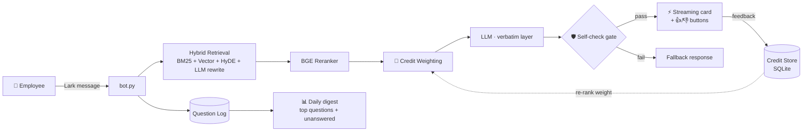

<div align="center">

# 🏢 HR Q&A Bot for Lark

**Enterprise-grade HR assistant — hallucination-free by design**

Answers are *verbatim transcriptions* from your knowledge base with source links.
The LLM never improvises. Ever.

[](https://www.python.org/)
[](https://www.larksuite.com/)
[](#-architecture)
[](#-feedback-credit-weighting)
[](LICENSE)

**English** · [简体中文](README.zh-CN.md) · [日本語](README.ja.md) · [한국어](README.ko.md)

</div>

---

## ✨ Why This Bot Is Different

Most RAG bots let the LLM *rewrite* retrieved content — and inherit its hallucinations.
This bot is built on the opposite principle:

> **The answer must be the original KB text, transcribed word-for-word, plus a source link. The model is a retrieval-and-formatting layer, never an author.**

| Feature | Description |
|---|---|
| 📜 **Verbatim Answers** | Strict prompt contract + citation verification: every claim traceable to KB text |
| 🏦 **Feedback Credit Weighting** | 👍/👎 feedback builds per-document credit scores that re-rank future retrieval — inspired by multi-agent trust scoring |
| 🛡️ **Confidence Gate** | LLM self-check before sending; unverifiable answers are downgraded or withheld entirely |
| ⚡ **Streaming Cards** | Lark interactive cards updated live as tokens generate, with feedback buttons |
| 🌐 **Bilingual** | Auto language detection (中文 / English), bilingual KB support |
| 🔄 **Self-Healing Loop** | Unanswered questions are logged → daily digest → admin confirms → KB improves |
| 🩺 **Production-Grade Ops** | In-process reconnect, fail-safe fuse, schedule-aware watchdog (launchd) |
| 📊 **Offline A/B Eval** | `eval_kb.py --compare` proves every change is non-regressing before shipping |

---

## 🏗 Architecture



---

## 🏦 Feedback Credit Weighting

Inspired by **trust scoring in multi-agent systems** (e.g. Manus), applied to the retrieval layer:

```
credit(doc)  = (👍 + α) / (👍 + 👎 + 2α)        # Bayesian smoothing, α = 2
weight(doc)  = W_min + (W_max − W_min) × credit  # ∈ [0.7, 1.3]
final_score  = reranker_score × weight(doc)
```

- New documents start **neutral** (credit 0.5 → weight 1.0) — no cold-start bias
- Repeatedly down-voted sources sink; verified sources rise
- **Ranking-only**: it never touches answer generation, so it cannot introduce hallucinations
- Validate before enabling: `python3 eval_kb.py --compare` runs the full eval suite with credit ON vs OFF and prints the delta

---

## 🛡️ Confidence Gate

Every generated answer is checked against the retrieved contexts by an LLM self-check.
If claims cannot be traced to KB text, the gate degrades gracefully:

| Mode | Behavior |
|---|---|
| `note` *(default)* | Send answer + append a verification disclaimer |
| `fallback` | **Withhold the answer entirely** — reply with a cautious fallback instead |

Configure in `config.py`: `SELF_CHECK_MODE = "fallback"`

---

## 🚀 Quick Start

```bash
# 1. Install dependencies
pip install lark-oapi openai numpy torch transformers sentencepiece

# 2. Configure (Lark app credentials / LLM gateway / admin open_id)
cp config.example.py config.py && vi config.py

# 3. Drop your policy docs into the knowledge base
cp your-policy.md kb/

# 4. Run
python3 bot.py
```

Optional — auto-sync KB from Lark wiki: `cp sync_sources.example.json sync_sources.json`, fill in doc URLs, then `python3 lark_sync.py`.

---

## 📁 Project Structure

| File | Role |
|---|---|
| `bot.py` | Main app: Lark WebSocket, message dispatch, card UI, reconnect & watchdog logic |
| `llm.py` | LLM layer: prompt contract, guards, streaming, self-check |
| `credit_store.py` | 🏦 Feedback credit weighting (SQLite) |
| `kb.py` · `index_manager.py` · `vector_store.py` · `reranker.py` | Hybrid retrieval pipeline |
| `question_log.py` | Question logging, feedback, daily digest |
| `kb_healer.py` | KB self-healing suggestions (admin-confirmed) |
| `lark_sync.py` | Auto-sync KB from Lark wiki/docx |
| `eval_kb.py` | Offline eval: LLM-as-judge grading + A/B compare |
| `watchdog.sh` | Schedule-aware external watchdog for launchd |

---

## 📊 Evaluation

```bash
python3 eval_kb.py              # full suite: faithfulness / completeness / link accuracy
python3 eval_kb.py --compare    # A/B: credit weighting OFF vs ON
python3 eval_kb.py --files 假期政策.md --limit 20   # quick debug run
```

Grading is done by LLM-as-judge across three axes: **faithfulness** (no claims beyond KB),
**completeness** (no missing key facts), **link accuracy** (correct source document).

---

## 🔧 Operations

- `launchd` KeepAlive + `watchdog.sh` (work-hours aware)
- Admin commands in Lark DM: `重载知识库` / `同步知识库`
- Every change is gated by `eval_kb.py` — no regression ships

---

<div align="center">

**License:** MIT · Built with ❤️ for HR teams

</div>
