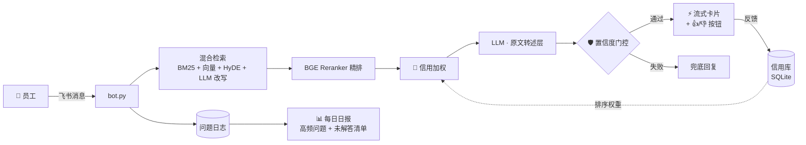

<div align="center">

# 🏢 飞书 HR 智能问答 Bot

**企业级 HR 助手——从机制上杜绝幻觉**

答案 = 知识库原文一字不差转述 + 来源链接推送。
大模型只做检索与排版，永远不当作者。

[](https://www.python.org/)
[](https://www.larksuite.com/)
[](#-架构)
[](#-反馈信用加权)
[](LICENSE)

[English](README.md) · **简体中文** · [日本語](README.ja.md) · [한국어](README.ko.md)

</div>

---

## ✨ 与众不同之处

大多数 RAG bot 让大模型"改写"检索到的内容——幻觉随之而来。
本项目的原则截然相反：

> **答案必须是知识库原文的一字不差转述，加上来源链接。模型是检索与排版层，永远不是作者。**

| 特性 | 说明 |
|---|---|
| 📜 **原文转述** | 严格的 Prompt 契约 + 引用核查：每个结论都能追溯到 KB 原文 |
| 🏦 **反馈信用加权** | 👍/👎 反馈累计为文档信用分，参与后续检索排序——受多 Agent 信用机制启发 |
| 🛡️ **置信度门控** | 发送前 LLM 自查；无法追溯原文的答案自动降级或整段拦截 |
| ⚡ **流式卡片** | 飞书交互卡片边生成边更新，带反馈按钮 |
| 🌐 **中英双语** | 自动识别提问语言，支持双语知识库 |
| 🔄 **自愈闭环** | 未解答问题静默记录 → 每日日报 → 管理员确认 → 知识库持续完善 |
| 🩺 **生产级运维** | 进程内重连 + 失败保险丝 + 作息感知看门狗（launchd） |
| 📊 **离线 A/B 评测** | `eval_kb.py --compare` 证明每次改动不回归才上线 |

---

## 🏗 架构



---

## 🏦 反馈信用加权

受多 Agent 系统**信用评分机制**（如 Manus）启发，迁移到 RAG 检索层：

```
信用分 = (👍 + α) / (👍 + 👎 + 2α)          # 贝叶斯平滑，α = 2
权重   = W_min + (W_max − W_min) × 信用分   # ∈ [0.7, 1.3]
最终分 = reranker 分数 × 权重
```

- 新文档天然**中性**（信用 0.5 → 权重 1.0），无冷启动偏差
- 被反复踩的来源自动沉底，被验证的优质来源自动靠前
- **只动排序**：不触碰答案生成链路，不可能引入幻觉
- 上线前先验证：`python3 eval_kb.py --compare` 一键对照信用加权 开/关 的准确率差异

---

## 🛡️ 置信度门控

每个答案在发出前都会经 LLM 自查与检索上下文比对。
无法追溯 KB 原文的结论按配置降级：

| 模式 | 行为 |
|---|---|
| `note`（默认） | 发送答案 + 追加核实免责提示 |
| `fallback` | **整段拦截**——宁可不发，回复保守兜底话术 |

在 `config.py` 中配置：`SELF_CHECK_MODE = "fallback"`

---

## 🚀 快速开始

```bash
# 1. 安装依赖
pip install -r requirements.txt

# 2. 配置（飞书应用凭证 / LLM 网关 / 管理员 open_id）
cp config.example.py config.py && vi config.py

# 3. 把制度文档放进知识库
cp 你的制度文档.md kb/

# 4. 启动
python3 bot.py
```

可选——从飞书 wiki 自动同步知识库：复制 `sync_sources.example.json` 为 `sync_sources.json`，填入文档链接后运行 `python3 lark_sync.py`。

---

## 📁 项目结构

| 文件 | 职责 |
|---|---|
| `bot.py` | 主程序：飞书 WS 长连接、消息分发、卡片 UI、重连与值守 |
| `llm.py` | LLM 层：Prompt 契约、守卫、流式生成、置信自查 |
| `credit_store.py` | 🏦 反馈信用加权（SQLite） |
| `kb.py` · `index_manager.py` · `vector_store.py` · `reranker.py` | 混合检索链路 |
| `question_log.py` | 问题记录、反馈收集、每日日报 |
| `kb_healer.py` | 知识库自愈建议（管理员确认制） |
| `lark_sync.py` | 从飞书 wiki/docx 自动同步知识库 |
| `eval_kb.py` | 离线评测：LLM-as-judge 评分 + A/B 对照 |
| `watchdog.sh` | 作息感知的外部看门狗（launchd） |

---

## 📊 评测

```bash
python3 eval_kb.py              # 完整评测：忠实度 / 完整性 / 链接准确率
python3 eval_kb.py --compare    # A/B：信用加权 关 vs 开
python3 eval_kb.py --files 假期政策.md --limit 20   # 快速调试
```

评分由 LLM-as-judge 完成，三个维度：**忠实度**（结论不超出原文）、**完整性**（不遗漏关键事实）、**链接准确率**（来源文档正确）。

---

## 🔧 运维

- `launchd` KeepAlive + `watchdog.sh`（工作时间值守）
- 管理员在飞书私聊 bot：`重载知识库` / `同步知识库`
- 所有改动先过 `eval_kb.py` 评测——不回归才上线

---

<div align="center">

**License:** MIT · 为 HR 团队用心打造 ❤️

</div>
